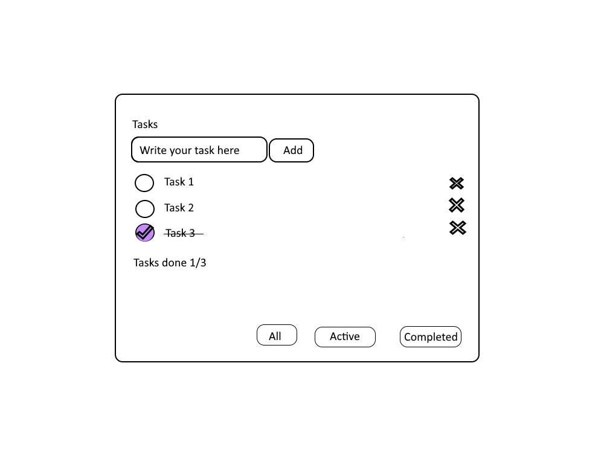
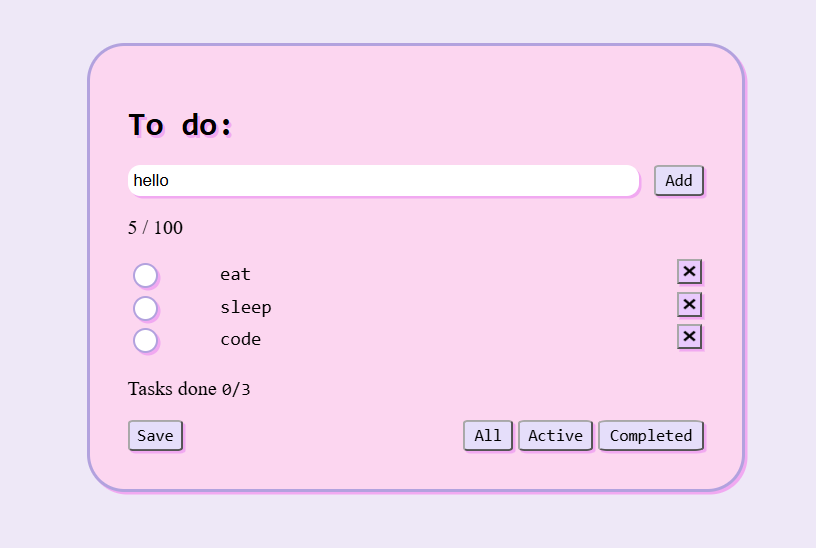

# To Do app

**Tekijä:** Katriina Chindjapin

## Projektisuunnitelma

### Projektin idea

Sovellus mihin voi merkata tehtäviä, mitä pitää suorittaa. Tehtävät merkataan valmiiksi kun ne ovat suoritettu. Sovellus sopii esimeksiksi opiskelijalle, jolla on paljon kurssitehtäviä.

### Suunnitellut toiminnot

Listaa vähintään kolme sovellukseesi suunniteltua toimintoa:

- Toiminto 1: Lisää tehtäviä.
- Toiminto 2: Poista tehtäviä.
- Toiminto 3: Merkkaa tehtävät valmiiksi.
- Toiminto 4: Fitteröi tehtäviä Valimis/Kesken nappuloilla.

### Rautalankamalli / luonnos

## Verkkolinkit

- **Julkaistu sovellus:** [Lisää tähän GitHub Pages -osoite](https://yourusername.github.io/your-repository/)
- **GitHub-repositorio:** [https://github.com/katriinac/todoapp](https://github.com/katriinac/todoapp)
- **Projektin videoesittely:** [Lisää tähän videon osoite](https://example.com/)

## Tietoja sovelluksesta

**[To Do]** on verkkosovellus, johon voi lisätä tehtäviä mitä haluaa suorittaa. Kun tehtävät ovat suoritettu, niin ne merkataan valmiiksi. Valmiita tai keskeneräisiä tehtäviä voi tarkastella nappien avulla. Tehtävät voi poistaa tarvittaessa.

## Teknologiat

- HTML – sivun rakenne
- CSS – ulkoasu ja asettelu
- JavaScript – toiminnallisuus, DOM-skriptaus ja lomakkeiden validointi
- localStorage – tietojen tallentaminen selaimeen, jos käytit sitä

## Sovelluksen käyttö

1. Avaa julkaistu sovellus yllä olevasta linkistä.
2. Täytä lomakkeen kenttä.
3. Lisää kohde valmiiksi.
4. Listää toinen kohde.
5. Tarkista kohteiden näkyvyyttä Active tai Completed napilla.
6. Paina All nappia.
7. Poista valmiit kohdat.
----- kesken
4. Päivitä sivu ja tarkista, säilyvätkö tiedot selaimessa, jos käytit localStoragea.

## Sovelluksen käynnistäminen paikallisesti

1. Kloonaa tai lataa tämä repositorio omalle koneellesi.
2. Avaa projektikansio.
3. Avaa `index.html` selaimessa.

## Kuvakaappaukset

## Tunnetut virheet / puutteet

Punainen reunus häviää inpustista vasta, kun uusi tehtävä on lisätty.

## Oma arvio ja oppimisen reflektointi

Pohdi työtäsi ja oppimisprosessiasi.

- Missä onnistuin? Sain mielestäni hyvin rakennettua toimivan sovelluksen ja kaikki vaatimukset toteutuvat.
- Mikä oli haastavaa? CSS:n lisääminen sivulle, checkboxien lisääminen ja poisto-toiminnon lisääminen.
- Mitä parantaisin, jos aikaa olisi enemmän? Jakaisin koodin selkeämmin osiin ja miettisin tapoja, miten voisin kirjoittaa koodin helpommin/lyhyemmin. Panostaisin vielä enemmän ulkonäköön.
- Mitä opin HTML:stä, CSS:stä, JavaScriptistä ja DOM-skriptauksesta? Käyttämällä näitä kaikkia, pystyy rakentamaan kaikenlaisia pieniä verkkosovelluksia.
- Oma arvio projektista: **10/10 pistettä**

## Lähteet ja kiitokset

Käytin enimmäkseen aijemmin tehtyjeni Workshop tehtäviä apuna koodin luomiseen (enimmäkseen workshop03 ja workshop04).
Käytin myös paljon W3schools esimerkkejä apuna (enimmäkseen CSS).

- [HTML DOM Input Checkbox Object](https://www.geeksforgeeks.org/html/html-dom-input-checkbox-object/) Käytin tutoriaalia apuna valintaruutujen luomiseen.

- [How to get all checked checkbox values using JavaScript by Joshua Colvin](https://www.joshuacolvin.net/blog/selected-checkbox-values/) Opin tutoriaalista, että voin käyttää querySelectorAll ja :checked, jonka avuilla sain tehtävät näkyviin painikkeita painaessa.

- [HTML DOM Document createTextNode()](https://www.w3schools.com/jsref/met_document_createtextnode.asp) Opin miten createTextNode toimii.

- [CSS Margins](https://www.w3schools.com/css/css_margin.asp) Opin, mitä eri margin ominaisuudet tekee ja mitä niistä tarvitsen projektiini.

- [CSS Fonts](https://www.w3schools.com/css/css_font.asp) Etin fontin projektiini.

- Kaikki käyttämät kuvat olen luonut itse käyttämällä paint.net ohjelmaa.

- Käytetty tekoälytyökalu: ChatGPT

  - Miten työkalua käytettiin: Kohteen poistettua, en saanut päivitettyä "tasks done 0/2" kohtaa (laski edelleen tehtäviä mitkä oli poistettu.). Kysyin tekoälyltä mitä koodissa oli vikana ja sain vastaukseksi selityksen, mikä ja missä oli vikaa. Olin merkannut funktiokutsut väärään kohtaan.

  - Kysyin miten saan jokaiselle poisto-napille oman id:n. Laitoin osan koodistani tekoälyyn, joka sitten neuvoi lisäämään osan koodia joka kasvattaa ID muuttujaa, jotta kaikilla näppäimillä olisi eri id.

  - Kysyin apua miten pystyn muokkaamaan valintaruudun ulkonäköä, siten että siihen jää ✓ näkyviin kun sitä on painettu. Sain vastaukseksi "input[type="checkbox"]:checked::after" kohdan css tiedostossa.

  ## Lisenssi

Tämä projekti on lisensoitu MIT-lisenssillä.

Lisätietoa lisenssin lisäämisestä GitHub-projektiin:
https://docs.github.com/en/communities/setting-up-your-project-for-healthy-contributions/adding-a-license-to-a-repository